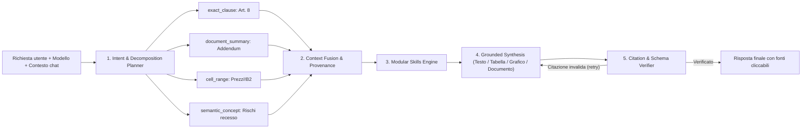

# Analisi UX-UI, Proposte Funzionali (Benchmark Legora) e Architettura dell'Orchestratore Agentico

## 1. Analisi UX-UI e Migliorie Implementate

### Punti di forza della base iniziale
- **Layout tri-colonna orientato alla verifica**: barra laterale pratiche/chat, conversazione centrale, ispettore documentale destro con evidenziazione delle coordinate esatte nel PDF e nelle celle Excel/CSV.
- **Trasparenza delle fonti**: citazioni inline cliccabili `[1]` e pannello *Dettagli* con traccia e versione del prompt.

### Criticità rilevate e interventi applicati
| Area | Criticità iniziale | Intervento UX-UI realizzato |
| --- | --- | --- |
| **Configurazione Chiave API** | Modificabile solo editando `.env` su disco | Sezione dedicata in *Configurazione → Assistente* con input mascherato, mostra/nascondi, salvataggio persistente su DB locale, test connessione live e rimozione immediata. Indicatore di stato cliccabile nella sidebar. |
| **Terminologia modelli** | "Archetipi" risultava astratto per il professionista legale | Rinominato in **Modelli di documenti**, con categorie legali (`Corrispondenza`, `Contrattualistica`, `Contenzioso`, `Pareri`, `Compliance`), ricerca, filtro per categoria, attributi flessibili (tono, destinatario, giurisdizione, regole clausole, coppie personalizzate) ed **esempi allegabili** (file o testo). |
| **Compilazione in chat** | Il modello selezionato veniva usato come semplice blocco di sistema senza barra di lavoro | Aggiunta **barra documento attivo** sopra il compositore con toggle *Mantieni attivo* per il raffinamento multi-turno, pannello rapido dei campi, card dedicata del documento compilato con stato campi completi/mancanti ed esportazione diretta in **DOCX**, **Markdown** e **Copia**. |
| **Cartelle di retrieval** | Solo upload file singoli, nessuna visibilità su cartelle locali | Nuovo pannello **Cartelle retrieval** accessibile da sidebar, compositore e inspector (`tab Cartelle`) con browser di directory integrato, stato attiva/in pausa, inclusione sottocartelle, sincronizzazione incrementale e badge di provenienza sui documenti. |
| **Resa dati in chat** | Solo testo e tabelle Markdown statiche | Nuovi componenti **RichTable** (ordinamento, filtro, badge rischio, esportazione CSV) e **ChartCard** SVG nativi (`bar`, `horizontal_bar`, `line`, `donut`, `timeline`), più selettore *Formato risposta* (`Auto`, `Tabella`, `Grafico`, `Documento`). |
| **Gestione ciclo di vita** | Impossibile eliminare pratiche, conversazioni o documenti | Azioni di eliminazione accessibili (su hover/focus) con modale di conferma sicura (`ConfirmModal`) e gestione pulita dello stato vuoto (0 pratiche). |
| **Responsività e accessibilità** | Textarea rigida a 44px, tabelle non scrollabili su schermi stretti | Textarea auto-espandibile fino a 200px, wrapper `.table-scroll` su tutte le tabelle, focus ring coerenti, stato di lavorazione esplicito e zero overflow orizzontale fino a 320px. |

---

## 2. Proposte di Miglioramenti Funzionali (Standard Legora & Legal-Tech)

Confrontando **Indice** con piattaforme enterprise come **Legora** (ex Leya), Harvey e CoCounsel, emergono le seguenti direttrici evolutive prioritarie:

1. **Tabular Review Multi-Documento (Griglia Due Diligence)**:
   - Matrice dove le **righe** rappresentano i documenti di un fascicolo o cartella (es. 50 contratti fornitori) e le **colonne** rappresentano quesiti strutturati (Legge applicabile, Foro, Preavviso, Cap di responsabilità, Rinnovo tacito).
   - Ogni cella contiene valore estratto + confidenza + citazione cliccabile verso il PDF originale, con stati di revisione umana (*Da verificare*, *Approvato*, *Bloccato*) e export Excel multi-foglio.
2. **Playbook di Studio & Redlining Contrattuale**:
   - Definizione di *Playbook* per tipologia contrattuale con: posizione ideale, posizioni di fallback accettabili e *red flag* inaccettabili.
   - Confronto automatico della bozza ricevuta dalla controparte rispetto al Playbook, con generazione di controproposte di clausole e **Add-in Microsoft Word** per applicare revisioni (*Track Changes*) e commenti direttamente in Word.
3. **Workflow Agentici No-Code Componibili**:
   - Pipeline multi-step salvabili e riutilizzabili per pratica (es. *Intake VDR → Estrazione date/scadenze → Verifica conformità GDPR/DPA → Compilazione Red Flag Report → Nota al cliente*).
4. **GraphRAG & Registro Entità/Scadenze**:
   - Grafo locale delle relazioni tra società, legali rappresentanti, contratti base, addendum modificativi e scadenze contrattuali, per rispondere con certezza a catene di modifiche (*Addendum 2 modifica Addendum 1 che modifica Art. 8 del Contratto*).
5. **Connettori Enterprise, OCR & Audit Trail**:
   - Connettori in sola lettura verso **iManage**, **SharePoint/OneDrive**, **Google Drive**, **PostgreSQL** e portali PEC/PST.
   - Pipeline **Document AI / OCR** per fascicoli scansionati con mantenimento delle coordinate `rects`.
   - Registro audit immutabile (chi ha interrogato cosa, quale versione del modello/prompt, quali fonti sono state citate) ed export fascicoli.

---

## 3. Architettura dell'Orchestratore Agentico Multi-Retrieval

### Principio di funzionamento
Una richiesta legale reale richiede spesso **contemporaneamente** strategie di recupero diverse sullo stesso turno: ad esempio, *"Riportami l'art. 8 del Contratto, riassumi l'Addendum, verifica il prezzo in Prezzi!B2 e valuta i rischi sul recesso"*. Un singolo retriever (solo vettoriale o solo regex) fallisce su almeno una parte della richiesta.

### I 5 Stadi della Pipeline (`server/orchestrator.py` + `server/assistant.py`)
1. **Intent & Decomposition Planner (`plan_turn`)**:
   - In modalità Gemini usa `PLAN_SCHEMA` (structured JSON) per scomporre la domanda in sub-task tipizzati; in modalità locale (e come rete di sicurezza deterministica) applica regole multi-intento che generano simultaneamente più task senza che la presenza di un numero d'articolo annulli la ricerca semantica o il riassunto.
2. **Multi-Strategy Retrieval Router (`execute_plan`)**:
   - Esegue i sub-task sui retriever specializzati rispettando i limiti delle cartelle attive (`enabled = 1`):
     - `exact_clause`: ricerca puntuale per articolo (`Art. 8`) e frasi letterali tra virgolette, includendo i commi adiacenti.
     - `cell_range`: risoluzione diretta di celle e intervalli Excel/CSV (`Prezzi!A2:B2`).
     - `semantic_concept`: fusione ibrida BM25 (SQLite FTS5) + Gemini Embedding (`gemini-embedding-2`) tramite Reciprocal Rank Fusion.
     - `document_summary`: estrazione mirata dei blocchi strutturali (`Art.`, `Premesse`, `Oggetto`, `Tabella`) per sintetizzare un intero documento.
     - `full_document`: caricamento integrale/multimodale (PDF nativi, immagini o tutti i passaggi).
3. **Context Fusion & Provenance Tagging**:
   - Deduplica i chunk per `id`, costruisce il catalogo delle fonti numerato e registra in `plan_steps` ogni strategia eseguita, query, filtro documento e numero di risultati.
4. **Modular Skills Engine (`AGENT_SKILLS`)**:
   - `citation_grounding` (sempre attiva): impone marcatori `[sID]` e citazione letterale.
   - `clause_comparison`: attiva su più fonti/addendum per distinguere decorrenze e prevalenza.
   - `legal_drafting`: attiva con un modello di documento; inietta struttura, regole clausole, attributi personalizzati, esempi di riferimento (solo stile/struttura) e istruzioni cumulative della chat.
   - `tabular_analytics`: attiva su richieste comparative, quantitative o cronologiche per popolare `tables` e `charts`.
5. **Citation & Schema Verifier (`verify`)**:
   - Verifica che ogni `[sID]` corrisponda a un chunk presente nel catalogo del turno e che la `quote` sia effettivamente contenuta nel testo originale (con retry automatico verso Gemini in caso di errore di citazione).

### Estensioni future dell'Orchestratore
- **Tool di calcolo termini e interessi legali** (scadenzario processuale/civile deterministico con festività italiane).
- **Tool di confronto diff/redline deterministico** tra versioni di clausole (word-level diff).
- **Sub-agent paralleli Map-Reduce** per l'estrazione Tabular Review su 100+ documenti con aggregazione finale.
